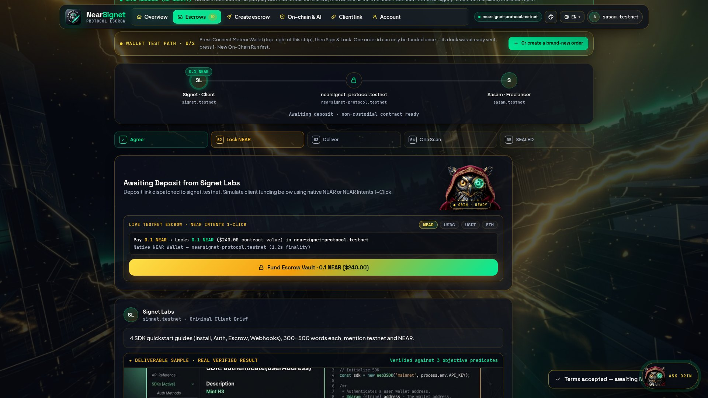
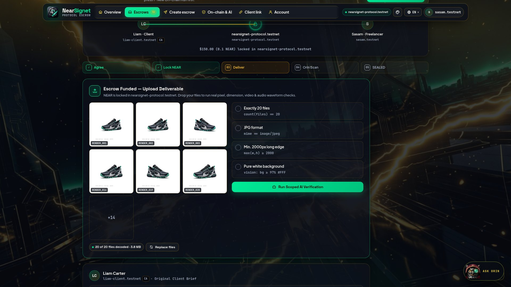
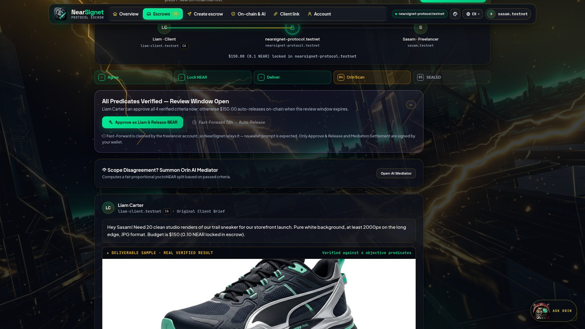
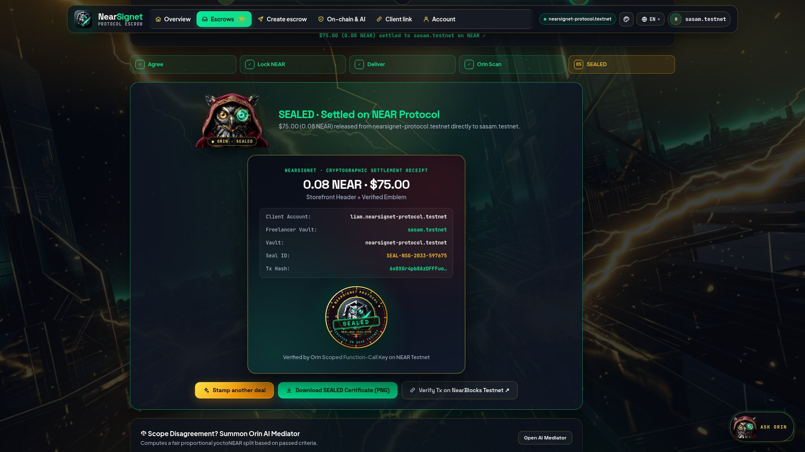
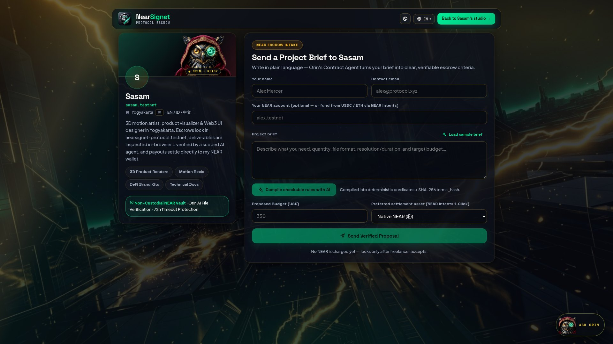
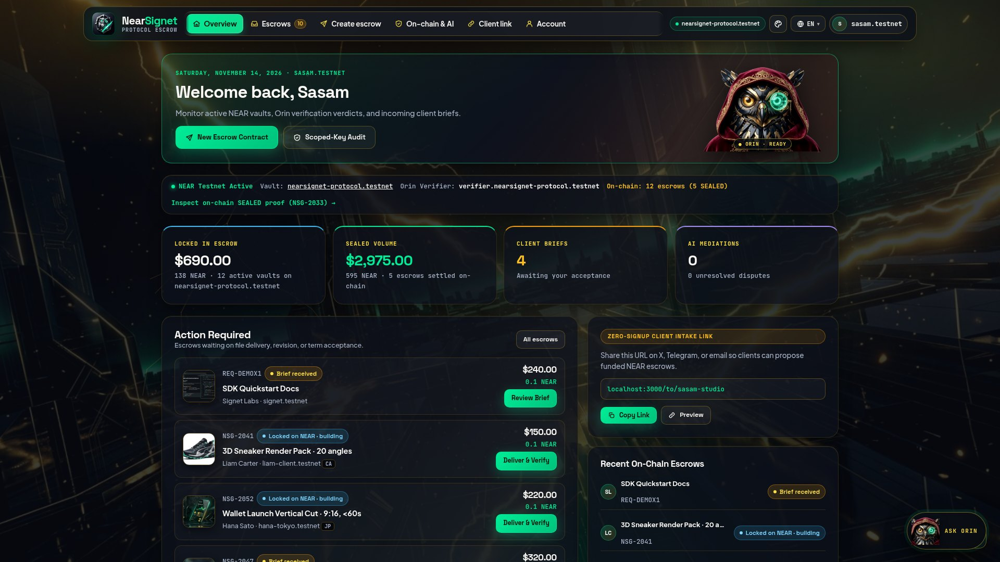
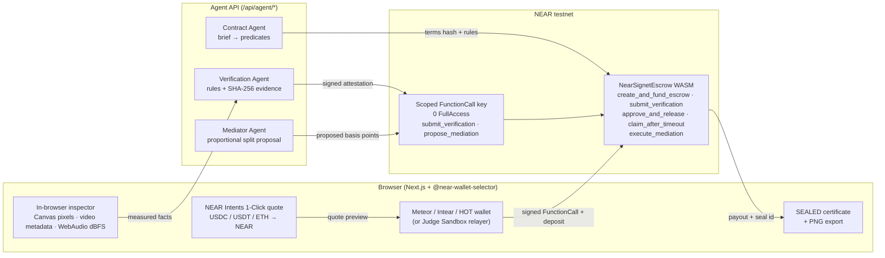

# NearSignet — AI-verified freelance escrow on NEAR

[](https://nearsignet.vercel.app)
[](./LICENSE)
[](https://testnet.nearblocks.io/address/nearsignet-protocol.testnet)
[](https://testnet.nearblocks.io/address/verifier.nearsignet-protocol.testnet)
[](https://nearhackathon.com)


**Live app: [nearsignet.vercel.app](https://nearsignet.vercel.app)** — connect a real NEAR testnet wallet (Meteor, Intear, HOT) or use the **Judge Sandbox** relayer, which broadcasts real transactions to `nearsignet-protocol.testnet`.

NearSignet is non-custodial freelance escrow on NEAR where an AI agent does the verification instead of the arguing. A client writes a plain-language brief; the app compiles it into deterministic file checks; the client locks NEAR in an on-chain escrow; the worker uploads into that funded order; the work is measured in the browser (pixel dimensions, background RGB purity, video duration/aspect, WebAudio dBFS loudness, document word count); then the AI agent records an attestation on-chain with a **scoped `FunctionCall` access key** that physically cannot move the escrowed funds.

---

## 1. The problem, and what NEAR does about it

A client and a freelancer who have never met need to trust each other with $400–$2,000. Platform escrow takes 6–20% and holds the money; paying directly means somebody moves first. Two failure modes:

1. **Vague brief, unpaid work.** Terms live in a chat thread, deliverables arrive, the client stalls or ghosts.
2. **AI with a wallet key.** Giving an autonomous verifier full custody to release funds invites prompt injection and key compromise.

| What the product needs | NEAR primitive used | Why it matters |
| :--- | :--- | :--- |
| An AI agent that can attest a verdict but never touch the money | **Scoped `FunctionCall` access key** on `verifier.nearsignet-protocol.testnet` (`receiver_id: nearsignet-protocol.testnet`, `method_names: ["submit_verification", "propose_mediation"]`, 0.25 NEAR gas cap, `FullAccess` key deleted on-chain) | If the agent is prompt-injected or the key leaks, the NEAR runtime itself rejects `approve_and_release`, `refund_escrow` and any transfer. |
| Money that stays put until the rules pass | **`NearSignetEscrow` WASM contract** on `nearsignet-protocol.testnet` + `@near-wallet-selector` | Funds sit in yoctoNEAR inside the contract. Once `submit_verification` records `all_passed: true` plus a SHA-256 evidence hash, a 72h on-chain timer opens `claim_after_timeout` if the client goes silent. |
| Clients holding USDC/USDT/ETH instead of NEAR | **NEAR Intents 1-Click quotes** (`/api/near/intents`) | A live conversion quote is previewed before locking; a deterministic offline quote is the fallback. |
| Rule drafting and dispute mediation | **NEAR AI Cloud** (`cloud-api.near.ai/v1`) + a deterministic rule engine | Powers the Contract Agent, Verification Agent and Mediator Agent in English, 中文 and Bahasa Indonesia; all AI paths have an offline fallback, so the flow never depends on a model being up. |

---

## 2. What it looks like

### The client locks the vault — the brief compiled into machine-checkable rules

*`/orders/REQ-DEMOX1` — the brief becomes `count`, `format`, `dimension` and `background` predicates, and the client funds the vault with one signed transaction.*

### The worker's files are measured, not guessed

*20 renders decoded in-browser: `Exact: 20 files`, `JPEG format`, `Min. 2000px long edge`, `Pure white background`. One grey-backdrop render gets flagged red before any AI opinion is involved.*

### Orin verifies every written rule

*`All Predicates Verified — Review Window Open`. Each predicate carries its own evidence; the verdict is signed by the scoped verifier key.*

### Settlement seals on-chain

*`SEALED · Settled on NEAR Protocol` — 0.08 NEAR, seal id `SEAL-NSG-2033-597675`, a real testnet tx hash and a downloadable PNG certificate.*

### Hiring starts from a link, not a chat thread

*`/to/sasam-studio` — a shareable worker profile that names the payout wallet; only the client can fund.*

### The client dashboard

*Locked escrow, sealed value, action-required queue and the guest intake link.*

> A 30-second screen recording of the same flow is attached to the demo post on X.

---

## 3. Live testnet deployment and on-chain proofs

Everything below is deployed on NEAR testnet (`https://rpc.testnet.near.org`) and public.

| Component | Identifier | Explorer |
| :--- | :--- | :--- |
| Escrow contract (544.8 KB WASM) | `nearsignet-protocol.testnet` | [NearBlocks ↗](https://testnet.nearblocks.io/address/nearsignet-protocol.testnet) |
| Contract deploy tx | `DfkegmyKGXutnFByGXThmJSsdemovXTZA1C33M2oofG5` | [View ↗](https://testnet.nearblocks.io/txns/DfkegmyKGXutnFByGXThmJSsdemovXTZA1C33M2oofG5) |
| `init` tx | `5VpVFYx1eoPaup6F542eNy7vi6gvqaGsZf1Vobw4ZkQE` | [View ↗](https://testnet.nearblocks.io/txns/5VpVFYx1eoPaup6F542eNy7vi6gvqaGsZf1Vobw4ZkQE) |
| Scoped verifier account (`0 FullAccess` keys) | `verifier.nearsignet-protocol.testnet` | [NearBlocks ↗](https://testnet.nearblocks.io/address/verifier.nearsignet-protocol.testnet) |
| `AddKey(FunctionCall)` + `DeleteKey(FullAccess)` tx | `ed25519:D31UDCjgL8S7o8QJUXTYQ2KR1N5CVyvwYhh9MjjUAKEP` | [View ↗](https://testnet.nearblocks.io/txns/7NYp3vQ7qthVy9YHsr75wut3m3zvAUTVyLzDyjkWm3tm) |
| Tx 1 — `create_and_fund_escrow` (`NSG-2033`, 0.5 NEAR) | `EquEciRe5UtZgmCXyksqmnyL3br4rNeK1YUE31fYWkAX` | [View ↗](https://testnet.nearblocks.io/txns/EquEciRe5UtZgmCXyksqmnyL3br4rNeK1YUE31fYWkAX) |
| Tx 2 — `submit_verification` (2/2 rules + SHA-256) | `48zAoThDXD31LpRYYFdXY62HVJ39sNgTJGxg3QUJQttn` | [View ↗](https://testnet.nearblocks.io/txns/48zAoThDXD31LpRYYFdXY62HVJ39sNgTJGxg3QUJQttn) |
| Tx 3 — `approve_and_release` (`SEAL-NSG-2033-597675`) | `6x8XGr4pb8AzDFFFuo7DVYGzfoGts5GxTsVc7qA13x5a` | [View ↗](https://testnet.nearblocks.io/txns/6x8XGr4pb8AzDFFFuo7DVYGzfoGts5GxTsVc7qA13x5a) |

### Check the on-chain state yourself (curl, nothing to install)

1. **Do** — list the verifier's access keys:

   ```bash
   curl -s https://rpc.testnet.near.org \
     -H "Content-Type: application/json" \
     -d '{"jsonrpc":"2.0","id":"1","method":"query","params":{"request_type":"view_access_key_list","finality":"final","account_id":"verifier.nearsignet-protocol.testnet"}}'
   ```

   **See** — exactly one key, a `FunctionCall` key scoped to `receiver_id: "nearsignet-protocol.testnet"` and `method_names: ["submit_verification", "propose_mediation"]`. No `FullAccess` key.

2. **Do** — read the settled escrow `NSG-2033`:

   ```bash
   curl -s https://rpc.testnet.near.org \
     -H "Content-Type: application/json" \
     -d '{"jsonrpc":"2.0","id":"1","method":"query","params":{"request_type":"call_function","finality":"final","account_id":"nearsignet-protocol.testnet","method_name":"get_escrow","args_base64":"eyJvcmRlcl9pZCI6Ik5TRy0yMDMzIn0="}}'
   ```

   **See** — JSON decoding to `"status":"SEALED"`, `"seal_id":"SEAL-NSG-2033-597675"`, `"verifier_account":"verifier.nearsignet-protocol.testnet"`, `"all_passed":true`.

---

## 4. Try it — "do X → see Y"

### A. Hosted app (2 minutes, no install)

1. **Do** — open **[nearsignet.vercel.app](https://nearsignet.vercel.app)**, skip the intro, click **Open App**. On `/signin`, either connect **Meteor Wallet (set the network to Testnet)**, **Intear** or **HOT Wallet**, or click **Launch Judge Sandbox** to use the live testnet relayer.
   **See** — `/dashboard` with live telemetry read from `nearsignet-protocol.testnet`.
2. **Do** — open the sandbox order **`/orders/REQ-DEMOX1`** and click **Accept Terms**.
   **See** — the brief compiled into the predicate list, and an amber **Fund Escrow Vault** button that locks 0.1 NEAR.
3. **Do** — open **`/orders/NSG-2041`**, scroll to the funded vault, click **Clean Set (20×2400px White)**, then **Run Scoped AI Verification**.
   **See** — 20 JPEGs measured in-browser (`Exact: 20 files`, `JPEG format`, `Min. 2000px long edge`, `Pure white background`), then *All Predicates Verified* with the scoped-key attestation and a clickable **Tx ↗** NearBlocks link.
4. **Do** — open the settled order **`/orders/NSG-2033`**.
   **See** — the `SEALED` certificate for 0.08 NEAR with seal id, release tx and **Download PNG**.

### B. Local, with the full test suite

```bash
npm --prefix contract ci
npm --prefix web ci
npm test          # contract + i18n + media + live RPC
npm run build && npm run start
```

Current results on this commit:

| Suite | Command | Result |
| :--- | :--- | :--- |
| Contract & AI key firewall | `npm run test:contract` | **14/14** assertions — compiled WASM, `0 FullAccess` invariant, 72h timeout, proportional mediation |
| Trilingual parity | `npm run test:i18n` | **721 keys, 0 missing** (EN / 中文 / ID) |
| Media rule engine | `npm run test:media` | pixel, PNG alpha, video duration, dBFS audio and "audio present" assertions pass |
| Live testnet RPC | `npm run test:rpc` | contract deployed, `NSG-2033` settled, verifier key scoped, `0 FullAccess` |
| Orin chat grounding | `node web/scripts/check-orin.cjs` | **9/9** |
| Wallet signing invariants | `node web/scripts/check-wallet.cjs` + `check-wallet-tx.cjs` | **7/7** |
| NEP-413 login proof | `node web/scripts/check-nep413.cjs` | **6/6** |

---

## 5. Architecture



```text
nearsignet/
├── LICENSE                              # MIT
├── README.md
├── package.json                         # root scripts: build / start / test:*
├── docs/
│   ├── hero-banner.jpg
│   ├── screenshots/                     # the six screenshots above (1920×1080)
│   └── originals/                       # v6 Orin bust artwork the PNG cut-outs were made from
├── contract/                            # NEAR smart contract (near-sdk-js v2 → WASM)
│   ├── src/escrow.ts                    # NearSignetEscrow: escrow, scoped verify, timeout, mediation
│   ├── artifacts/nearsignet_escrow.wasm # compiled binary deployed to nearsignet-protocol.testnet
│   ├── scripts/deploy-testnet.mjs       # secret-free reproducible deploy + scoped-key setup
│   └── tests/escrow.test.mjs            # contract & AI key-firewall assertions
└── web/                                 # Next.js app
    ├── app/                             # App Router pages + 14 API routes
    ├── components/                      # DeliveryPanel, SealedCertificatePanel, SignetSeal, Orin, CinematicIntro…
    ├── lib/                             # wallet selector, NEAR RPC client, media verifier, trilingual dictionary
    ├── scripts/                         # i18n, media, live-RPC, Orin, wallet and NEP-413 checks
    └── public/                          # brand assets and sample deliverables
```

---

## 6. NEAR Hackathon track alignment

- **`security` — AI Security & Defense**: proves on-chain how to give an AI agent autonomous verification and mediation authority with **0 `FullAccess` keys**, using NEAR's native `FunctionCall` method scoping and a 0.25 NEAR gas cap.
- **`realworld` — Real-World Money**: non-custodial cross-border freelance escrow with real wallet signing, `/to/[handle]` intake links, Intents quotes for USDC/USDT/ETH clients, and exportable settlement certificates.
- **`agents` — Agent Economy** (also fits **`business`**): three specialised agents (Contract Drafter, Deliverable Verifier, Dispute Mediator) on NEAR AI Cloud, with deterministic offline fallbacks.

## 7. Libraries, tooling and originality (Q-005 / Q-014)

Everything in this repository — the `NearSignetEscrow` contract, the testnet deployment, the scoped-key firewall, the wallet-selector integration, the Intents and NEAR AI Cloud wiring, the `SignetSeal` certificate, the Orin artwork and the trilingual UI — was written during the hackathon window (2026-11-01 → 2026-11-14) and is released under the MIT License.

| Package / service | Purpose | Licence / access |
| :--- | :--- | :--- |
| `near-sdk-js` `^2.0.0` | TypeScript → WASM contract SDK | MIT / Apache-2.0 |
| `near-api-js` `^5.0.1` | NEAR JSON-RPC queries and signing | MIT / Apache-2.0 |
| `@near-wallet-selector/*` `10.1.4` | Browser wallet connection (Meteor, Intear, HOT) | MIT / Apache-2.0 |
| `next` `^16.4.6`, `react` `^19.3.1` | Web app and API routes | MIT |
| `html-to-image` `^1.11.13` | Client-side PNG export of the certificate | MIT |
| NEAR Intents 1-Click API | Cross-chain quote preview | public API |
| NEAR AI Cloud (`cloud-api.near.ai`) | TEE-backed LLM for the Contract and Mediator agents | NEAR AI Cloud |

## 8. Licence

**[MIT](./LICENSE)** — `SPDX-License-Identifier: MIT`.
