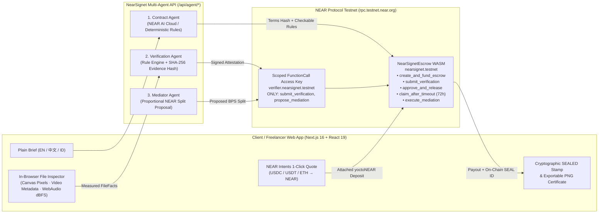

# NearSignet (`nearsignet.testnet`)

[](./LICENSE)
[](https://testnet.nearblocks.io/address/nearsignet.testnet)
[](https://testnet.nearblocks.io/address/verifier.nearsignet.testnet)
[](https://nearhackathon.com)


**NearSignet** is a non-custodial cross-border freelance escrow protocol on **NEAR** where specialized AI agents convert plain-language briefs into deterministic file checks, inspect real deliverables in the browser (pixel dimensions, background RGB purity, video duration/aspect ratio, WebAudio dBFS loudness, document word count), and record cryptographic attestations on-chain using a **NEAR Scoped Function-Call Access Key** that physically cannot move escrowed funds.

---

## 1. Problem & Concrete Role of NEAR Protocol

Cross-border freelancers, designers, and independent studios lose **6–20%** to custodial platform fees and FX spreads while facing two structural failure modes:
1. **Subjective "ghosting" & unpaid revisions**: Clients give vague instructions in chat, receive final deliverables, and stall or disappear before releasing payment.
2. **AI wallet key risk**: Giving an autonomous AI verifier a full-access wallet key to manage escrow introduces catastrophic prompt-injection and key-compromise risk.

### What NEAR Enables in NearSignet

| Capability | NEAR Primitive Used | Why It Matters |
| :--- | :--- | :--- |
| **Protocol-Enforced AI Firewall** | **Scoped `FunctionCall` Access Key** on `verifier.nearsignet.testnet` (`receiver_id: "nearsignet.testnet"`, `method_names: ["submit_verification", "propose_mediation"]`, `0.25 NEAR` gas cap, **zero `FullAccess` keys**) | Even if an AI agent is prompt-injected or its runtime key leaks, the NEAR runtime rejects `approve_and_release`, `refund_escrow`, and token transfers at the protocol layer. |
| **Non-Custodial Escrow + 72h Auto-Release** | **`NearSignetEscrow` WASM smart contract** (`nearsignet.testnet`) using `near.blockTimestamp()` | Funds lock directly in yoctoNEAR. Once `submit_verification` records `all_passed: true` + `SHA-256` evidence hash, a **72-hour on-chain timer** allows the freelancer to call `claim_after_timeout` trustlessly if the client goes silent. |
| **Cross-Chain Client Funding Quotes** | **NEAR Intents 1-Click API** (`https://1click.chaindefuser.com/v0/quote` via `/api/near/intents`) | Clients holding `USDC`, `USDT`, or `ETH` preview live conversion quotes into `NEAR` escrow before locking funds (with deterministic offline quote fallback). |
| **Multi-Agent AI Drafting & Mediation** | **NEAR AI Cloud** (`https://cloud-api.near.ai/v1`, `DeepSeek-V3.1`) + deterministic offline rule engine | Powers 3 agents (**Contract Agent**, **Verification Agent**, **Mediator Agent**) across **English**, **中文**, and **Bahasa Indonesia** — working out of the box with **zero API keys required**. |

---

## 2. Live NEAR Testnet Deployment & On-Chain Proofs

Every smart contract, scoped key, and full escrow settlement lifecycle is deployed and publicly verifiable on **NEAR Testnet** (`https://rpc.testnet.near.org`):

| Component | Identifier / Hash | Public Explorer Link |
| :--- | :--- | :--- |
| **Escrow Smart Contract (`544.8 KB` WASM)** | `nearsignet.testnet` | [NearBlocks Contract ↗](https://testnet.nearblocks.io/address/nearsignet.testnet) |
| **Contract Deploy WASM Tx** | `GBmnaHB3Z1QT4UxqLxNm4Cx3awwpkNzzdF9Pp6XZLcXv` | [View Deploy Tx ↗](https://testnet.nearblocks.io/txns/GBmnaHB3Z1QT4UxqLxNm4Cx3awwpkNzzdF9Pp6XZLcXv) |
| **Contract `init` Tx** | `3XJ8A1unaRiu5atABQUXWeCaqveJ4FHR9KxPERhsftMp` | [View Init Tx ↗](https://testnet.nearblocks.io/txns/3XJ8A1unaRiu5atABQUXWeCaqveJ4FHR9KxPERhsftMp) |
| **Scoped AI Verifier Account** | `verifier.nearsignet.testnet` | [NearBlocks Verifier ↗](https://testnet.nearblocks.io/address/verifier.nearsignet.testnet) |
| **Scoped `AddKey` Tx (`FunctionCall` only)** | `ed25519:7oHoeaUfJivi24jQS1E329UHnxdjbR6EReeEciETki1t` | [View AddKey Tx ↗](https://testnet.nearblocks.io/txns/E5NwjcjgJwVLe1G2JDXSvpA7Tf5GG31JDycfiT99eUrp) |
| **Tx 1 — `create_and_fund_escrow` (`NSG-2033`, `1.5 NEAR`)** | `D3h4bQb6JNcHV1P7KBTimFrgVRiuHZtXEHYhjo9ogBjH` | [View Lock Tx ↗](https://testnet.nearblocks.io/txns/D3h4bQb6JNcHV1P7KBTimFrgVRiuHZtXEHYhjo9ogBjH) |
| **Tx 2 — `submit_verification` (`2/2` rules + `SHA-256`)** | `6E28kcS2ph2gUQFwouqqeUaBnrgDEowNktmxsnEmXgu9` | [View Verify Tx ↗](https://testnet.nearblocks.io/txns/6E28kcS2ph2gUQFwouqqeUaBnrgDEowNktmxsnEmXgu9) |
| **Tx 3 — `approve_and_release` (`SEAL-NSG-2033-034003`)** | `GM3AHKng3oHVbF3djXaYZouKWwtBKZU1mYGxB7onknVF` | [View Release Tx ↗](https://testnet.nearblocks.io/txns/GM3AHKng3oHVbF3djXaYZouKWwtBKZU1mYGxB7onknVF) |

### Verify On-Chain State Directly via `curl` (No Install Needed)

1. **Do**: Query settled escrow `NSG-2033` from `nearsignet.testnet`:
   ```bash
   curl -s https://rpc.testnet.near.org \
     -H "Content-Type: application/json" \
     -d '{"jsonrpc":"2.0","id":"1","method":"query","params":{"request_type":"call_function","finality":"final","account_id":"nearsignet.testnet","method_name":"get_escrow","args_base64":"eyJvcmRlcl9pZCI6Ik5TRy0yMDMzIn0="}}'
   ```
   **See**: JSON byte array decoding to `"status":"SEALED"`, `"seal_id":"SEAL-NSG-2033-034003"`, `"verifier_account":"verifier.nearsignet.testnet"`, and `"all_passed":true`.

2. **Do**: Inspect the on-chain access keys of `nearsignet.testnet`:
   ```bash
   curl -s https://rpc.testnet.near.org \
     -H "Content-Type: application/json" \
     -d '{"jsonrpc":"2.0","id":"1","method":"query","params":{"request_type":"view_access_key_list","finality":"final","account_id":"nearsignet.testnet"}}'
   ```
   **See**: `ed25519:7oHoeaUfJivi24jQS1E329UHnxdjbR6EReeEciETki1t` restricted strictly to `FunctionCall` with `method_names: ["submit_verification", "propose_mediation"]` and `receiver_id: "nearsignet.testnet"`.

---

## 3. How to Run & Verify ("Do X → See Y" Judge Guide)

### Prerequisites
- **Node.js `>= 20`** and `npm`
- **Zero private keys or API keys required**: all `.env` settings default to public NEAR Testnet endpoints (`web/.env.example`).

### Step A — Automated Test Suite (Contract + i18n + Media Verifier + Live NEAR RPC)

**Do**:
```bash
npm --prefix contract ci
npm --prefix web ci
npm test
```

**See**:
1. **`test:contract` (`14/14` passed)**: Verifies compiled `nearsignet_escrow.wasm` (`544.8 KB`), `create_and_fund_escrow`, unauthorized caller rejection on `submit_verification` (AI firewall test), revision loops, premature timeout rejection (<72h), post-72h `claim_after_timeout`, and proportional `execute_mediation` yoctoNEAR splits.
2. **`test:i18n` (`584/584` keys passed)**: Confirms complete parity across `English`, `中文`, and `Bahasa Indonesia` with zero missing keys.
3. **`test:media`**: Evaluates real video, audio, and image acceptance rules (`duration_s`, `aspect`, `audio == mixed`, `audio_dbfs`, `count(videos)`).
4. **`test:rpc`**: Queries live `https://rpc.testnet.near.org` to verify `nearsignet.testnet` contract metrics, `NSG-2033` `SEALED` proof, and `FunctionCall` key scope.

### Step B — Start the Web Application Locally

**Do**:
```bash
npm run build
npm run start
```
Open **`http://localhost:3000`**.

### Step C — 60-Second Interactive Walkthrough ("Do X → See Y")

1. **Pre-Entry Intro → Landing Telemetry**
   - **Do**: Watch the opening trailer featuring **Orin** (Cyber-Inspector Owl) or click **`Skip Intro →`** in the top-right corner.
   - **See**: The Landing Page loads live Testnet stats from `nearsignet.testnet` (`Escrows`, `SEALED`, `Locked NEAR`) and an interactive cryptographic **`SEALED`** stamp showcase at the bottom.
2. **1-Click Judge Sandbox (Zero Wallet Extension Required)**
   - **Do**: Click **`Open App`** in the top glass navbar (or click **`1-Click Judge Sandbox`** on `/signin`).
   - **See**: Instant authenticated session as `raka-studio.testnet` on `/dashboard` with live Testnet telemetry.
3. **Catch a Defective Deliverable Before Escrow Can Unlock (`/orders/NSG-2041`)**
   - **Do**: Open order **`NSG-2041`** (*3D Token Launch Asset Pack — `70.0 NEAR`*) and click **`Load Sample Batch (19 clean + #14 defective)`**.
   - **See**: Your browser synthesizes 20 real `2400×2400` JPEG images in memory where image `#14` intentionally has an off-white `#D6DEDB` background.
   - **Do**: Click **`Run AI Verification`**.
   - **See**: Orin inspects pixel borders across all 20 files, computes a `SHA-256` evidence hash, flags file `#14` as failing the pure-white background rule, transitions status to **`REVISION NEEDED`**, and keeps all `70.0 NEAR` locked.
4. **Fix Deliverable → Pass Verification → Cryptographic `SEALED` Stamp Ceremony**
   - **Do**: Click **`Fix #14 & Re-upload Clean Batch`**, then click **`Run AI Verification`**.
   - **See**: All `3/3` rules pass (`IN_REVIEW`) and the **72-hour `blockTimestamp` auto-release countdown** starts.
   - **Do**: Click **`Approve & Release NEAR`** (or **`Simulate 72h Timeout → Auto-Release`**).
   - **See**: The `Ⓝ` payout rail settles to `raka-studio.testnet`, and the cryptographic **`SEALED` Signet Stamp** (with the 3D NearSignet emblem embedded inside the seal) slams onto the **On-Chain Escrow Settlement Certificate** with hydraulic recoil, radial sparks, and **1-click PNG certificate export (`Download PNG`)**.
5. **Audit Live Scoped Key Firewall & Live Settled Testnet Order**
   - **Do**: Open **`/insights`** and **`/orders/NSG-2033`**.
   - **See**: `/insights` renders the live `access_key_list` JSON from `rpc.testnet.near.org` proving `0 FullAccess` keys on the AI verifier, and `/orders/NSG-2033` links directly to live NearBlocks transaction `GM3AHKng3oHVbF3djXaYZouKWwtBKZU1mYGxB7onknVF`.

---

## 4. System Architecture & Repository Structure



```text
nearsignet/
├── LICENSE                           # Canonical OSI MIT License
├── README.md                         # Architecture, live Testnet proofs & Do-X-See-Y guide
├── package.json                      # Root scripts (build, start, 4-part automated test suite)
├── contract/                         # NEAR Smart Contract (near-sdk-js v2 -> WASM)
│   ├── src/escrow.ts                 # NearSignetEscrow contract (escrow, scoped verify, 72h timeout, mediation)
│   ├── artifacts/
│   │   └── nearsignet_escrow.wasm    # Compiled 544.8 KB WebAssembly binary deployed to nearsignet.testnet
│   ├── scripts/deploy-testnet.mjs    # Secret-free reproducible NEAR Testnet deploy + scoped-key setup
│   └── tests/escrow.test.mjs         # 14-assertion contract & AI key-firewall test suite
├── web/                              # Next.js 16 + React 19 + near-api-js v5 Web Application
│   ├── .env.example                  # Documented optional env vars (zero secrets required)
│   ├── app/                          # App Router pages (/, /signin, /to/[handle], /dashboard, /orders/*, /insights, /profile) + 12 API routes
│   ├── components/                   # SignetSeal, CinematicIntro, GoldenAtmosphere, Mascot (Orin), MoneyRail, DeliveryPanel, AppShell
│   ├── lib/                          # NEAR JSON-RPC client, deterministic media verifier, 584-key trilingual dictionary
│   └── scripts/                      # Automated i18n, media rule, and live NEAR RPC verification scripts
└── docs/hero-banner.jpg              # Project hero banner
```

---

## 5. Deployment (Vercel / Self-Hosted)

- **Vercel Setup**: Import the GitHub repository and set **Root Directory** to **`web`** (Framework Preset: `Next.js`).
- **Environment Variables**: None required for judging or live NEAR Testnet verification (`web/.env.example` provides safe public defaults pointing to `nearsignet.testnet` and `https://rpc.testnet.near.org`). Optional `NEAR_AI_API_KEY` (`https://cloud.near.ai`) and `NEAR_VERIFIER_SCOPED_KEY` can be supplied in server environment variables.

---

## 6. NEAR Hackathon Track Alignment (`nearhackathon.com`)

- **`security` — 06 / AI Security & Defense**: Demonstrates how to give AI agents real operational power over on-chain escrow **without giving them custody or `FullAccess` keys**, using NEAR's native `FunctionCall` key method scoping (`["submit_verification", "propose_mediation"]`) and gas allowance caps (`0.25 NEAR`).
- **`realworld` — 08 / Real-World Money**: Turns cross-border freelance invoicing and deliverable handoff into programmable non-custodial escrow with shareable `/to/[handle]` intake links, NEAR Intents `USDC`/`USDT`/`ETH` → `NEAR` quote previews, 72-hour ghosting protection, and exportable `SEALED` settlement certificates.
- **`agents` — 07 / Agent Economy & `business` — 04 / Autonomous Business**: Coordinates three specialized agents (Contract Drafter, Deliverable Verifier, Dispute Mediator) compatible with `NEAR AI Cloud` (`cloud-api.near.ai/v1`).

---

## 7. Open-Source Libraries, Tooling & Originality Disclosure (`Q-005` / `Q-014`)

- **Hackathon Window**: Built during the **NEAR HACKATHON (`November 1 – November 14, 2026`)**. Every smart contract (`NearSignetEscrow`), NEAR Testnet deployment (`nearsignet.testnet`, `verifier.nearsignet.testnet`), Scoped `FunctionCall` key firewall, NEAR Intents & NEAR AI Cloud integration, cryptographic `SignetSeal` stamp ceremony, **Orin** artwork/intro trailer, and 584-key trilingual UI in this repository were created for this submission and are released openly under the MIT License.
- **Open-Source Dependencies & Public APIs Used**:

| Package / Service | Purpose | License / Access |
| :--- | :--- | :--- |
| `near-sdk-js` (`^2.0.0`) | TypeScript-to-WASM smart contract SDK for `NearSignetEscrow` | `MIT` / `Apache-2.0` |
| `near-api-js` (`^5.0.1`) | NEAR JSON-RPC queries, transaction signing & `FunctionCall` key inspection | `MIT` / `Apache-2.0` |
| `next` (`^16.4.6`) & `react` (`^19.3.1`) | Full-stack web application & API routes | `MIT` |
| `html-to-image` (`^1.11.13`) | Client-side PNG export of `SEALED` settlement certificates | `MIT` |
| NEAR Testnet Public RPC (`rpc.testnet.near.org`) | Live contract state & access-key verification | Public NEAR RPC |
| NEAR Intents 1-Click API (`1click.chaindefuser.com`) | Cross-chain `USDC` / `USDT` / `ETH` → `NEAR` conversion quotes | Public API (`Q-006`) |
| NEAR AI Cloud (`cloud-api.near.ai/v1`) | Optional LLM endpoint for Contract & Mediator agents (offline fallback built in) | NEAR AI Cloud |

---

## 8. License

Distributed under the **[MIT License](./LICENSE)** (`SPDX-License-Identifier: MIT`).
