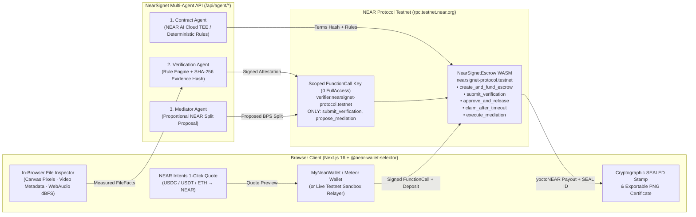

# NearSignet (`nearsignet-protocol.testnet`)

[](https://nearsignet.vercel.app)
[](./LICENSE)
[](https://testnet.nearblocks.io/address/nearsignet-protocol.testnet)
[](https://testnet.nearblocks.io/address/verifier.nearsignet-protocol.testnet)
[](https://nearhackathon.com)


> **Live Hosted App**: **[https://nearsignet.vercel.app](https://nearsignet.vercel.app)** — Connect your real **NEAR Testnet Wallet (`MyNearWallet` / `Meteor Wallet`)** OR use the **1-Click Live Testnet Relayer Sandbox** (every step broadcasts real transactions on `nearsignet-protocol.testnet` verifiable on NearBlocks).

**NearSignet** is a non-custodial cross-border freelance escrow protocol on **NEAR** where specialized AI agents convert plain-language briefs into deterministic file checks, inspect real deliverables in the browser (pixel dimensions, background RGB purity, video duration/aspect ratio, WebAudio dBFS loudness, document word count), and record cryptographic attestations on-chain using a **NEAR Scoped Function-Call Access Key** (`0 FullAccess` keys on-chain) that physically cannot move escrowed funds.

---

## 1. Problem & Concrete Role of NEAR Protocol

Cross-border freelancers, designers, and independent studios lose **6–20%** to custodial platform fees and FX spreads while facing two structural failure modes:
1. **Subjective "ghosting" & unpaid revisions**: Clients give vague instructions in chat, receive final deliverables, and stall or disappear before releasing payment.
2. **AI wallet key risk**: Giving an autonomous AI verifier a full-access wallet key to manage escrow introduces catastrophic prompt-injection and key-compromise risk.

### What NEAR Enables in NearSignet

| Capability | NEAR Primitive Used | Why It Matters |
| :--- | :--- | :--- |
| **Protocol-Enforced AI Firewall (`0 FullAccess` Keys)** | **Scoped `FunctionCall` Access Key** on `verifier.nearsignet-protocol.testnet` (`receiver_id: "nearsignet-protocol.testnet"`, `method_names: ["submit_verification", "propose_mediation"]`, `0.25 NEAR` gas cap, `FullAccess` key deleted on-chain) | Even if an AI agent is prompt-injected or its runtime key leaks, the NEAR runtime rejects `approve_and_release`, `refund_escrow`, and token transfers at the protocol layer. |
| **Non-Custodial Escrow + Timeout Auto-Release** | **`NearSignetEscrow` WASM smart contract** (`nearsignet-protocol.testnet`) + `@near-wallet-selector` (`MyNearWallet` & `Meteor Wallet`) | Funds lock directly in yoctoNEAR. Once `submit_verification` records `all_passed: true` + `SHA-256` evidence hash, an on-chain `near.blockTimestamp()` timer allows `claim_after_timeout` if the client goes silent. |
| **Cross-Chain Client Funding Quotes** | **NEAR Intents 1-Click API** (`https://1click.chaindefuser.com/v0/quote` via `/api/near/intents`) | Clients holding `USDC`, `USDT`, or `ETH` preview live conversion quotes into `NEAR` escrow before locking funds (with deterministic offline quote fallback). |
| **Multi-Agent Private AI Inference** | **NEAR AI Cloud TEE** (`https://cloud-api.near.ai/v1/chat/completions`, `zai-org/GLM-5.1-FP8` / `DeepSeek-V3.1`) + deterministic rule engine | Powers 3 agents (**Contract Agent**, **Verification Agent**, **Mediator Agent**) across **English**, **中文**, and **Bahasa Indonesia**. |

---

## 2. Live NEAR Testnet Deployment & On-Chain Proofs

Every smart contract, zero-`FullAccess` scoped verifier key, and full escrow settlement lifecycle is deployed and publicly verifiable on **NEAR Testnet** (`https://rpc.testnet.near.org`):

| Component | Identifier / Hash | Public Explorer Link |
| :--- | :--- | :--- |
| **Escrow Smart Contract (`544.8 KB` WASM)** | `nearsignet-protocol.testnet` | [NearBlocks Contract ↗](https://testnet.nearblocks.io/address/nearsignet-protocol.testnet) |
| **Contract Deploy WASM Tx** | `DfkegmyKGXutnFByGXThmJSsdemovXTZA1C33M2oofG5` | [View Deploy Tx ↗](https://testnet.nearblocks.io/txns/DfkegmyKGXutnFByGXThmJSsdemovXTZA1C33M2oofG5) |
| **Contract `init` Tx** | `5VpVFYx1eoPaup6F542eNy7vi6gvqaGsZf1Vobw4ZkQE` | [View Init Tx ↗](https://testnet.nearblocks.io/txns/5VpVFYx1eoPaup6F542eNy7vi6gvqaGsZf1Vobw4ZkQE) |
| **Scoped AI Verifier Account (`0 FullAccess` Keys)** | `verifier.nearsignet-protocol.testnet` | [NearBlocks Verifier ↗](https://testnet.nearblocks.io/address/verifier.nearsignet-protocol.testnet) |
| **Atomic `AddKey(FunctionCall)` + `DeleteKey(FullAccess)` Tx** | `ed25519:D31UDCjgL8S7o8QJUXTYQ2KR1N5CVyvwYhh9MjjUAKEP` | [View Key Lockdown Tx ↗](https://testnet.nearblocks.io/txns/7NYp3vQ7qthVy9YHsr75wut3m3zvAUTVyLzDyjkWm3tm) |
| **Tx 1 — `create_and_fund_escrow` (`NSG-2033`, `0.5 NEAR`)** | `EquEciRe5UtZgmCXyksqmnyL3br4rNeK1YUE31fYWkAX` | [View Lock Tx ↗](https://testnet.nearblocks.io/txns/EquEciRe5UtZgmCXyksqmnyL3br4rNeK1YUE31fYWkAX) |
| **Tx 2 — `submit_verification` (`2/2` rules + `SHA-256`)** | `48zAoThDXD31LpRYYFdXY62HVJ39sNgTJGxg3QUJQttn` | [View Scoped Verify Tx ↗](https://testnet.nearblocks.io/txns/48zAoThDXD31LpRYYFdXY62HVJ39sNgTJGxg3QUJQttn) |
| **Tx 3 — `approve_and_release` (`SEAL-NSG-2033-597675`)** | `6x8XGr4pb8AzDFFFuo7DVYGzfoGts5GxTsVc7qA13x5a` | [View Release Tx ↗](https://testnet.nearblocks.io/txns/6x8XGr4pb8AzDFFFuo7DVYGzfoGts5GxTsVc7qA13x5a) |

### Verify On-Chain State Directly via `curl` (No Install Needed)

1. **Do**: Inspect the access keys of `verifier.nearsignet-protocol.testnet`:
   ```bash
   curl -s https://rpc.testnet.near.org \
     -H "Content-Type: application/json" \
     -d '{"jsonrpc":"2.0","id":"1","method":"query","params":{"request_type":"view_access_key_list","finality":"final","account_id":"verifier.nearsignet-protocol.testnet"}}'
   ```
   **See**: Exactly **1 key** (`0 FullAccess` keys), strictly scoped to `FunctionCall` with `receiver_id: "nearsignet-protocol.testnet"` and `method_names: ["submit_verification", "propose_mediation"]`.

2. **Do**: Query settled escrow `NSG-2033` from `nearsignet-protocol.testnet`:
   ```bash
   curl -s https://rpc.testnet.near.org \
     -H "Content-Type: application/json" \
     -d '{"jsonrpc":"2.0","id":"1","method":"query","params":{"request_type":"call_function","finality":"final","account_id":"nearsignet-protocol.testnet","method_name":"get_escrow","args_base64":"eyJvcmRlcl9pZCI6Ik5TRy0yMDMzIn0="}}'
   ```
   **See**: JSON byte array decoding to `"status":"SEALED"`, `"seal_id":"SEAL-NSG-2033-597675"`, `"verifier_account":"verifier.nearsignet-protocol.testnet"`, and `"all_passed":true`.

---

## 3. How to Run & Verify ("Do X → See Y" Judge Guide)

### Step A — Try Live at [https://nearsignet.vercel.app](https://nearsignet.vercel.app) (Real Wallet OR Live Relayer)

1. **Sign In with Real NEAR Wallet OR Live Testnet Relayer**
   - **Do**: Open **`https://nearsignet.vercel.app`**, watch or skip the opening trailer, and click **`Open App`**. On `/signin`, click **`Connect MyNearWallet (Testnet)`** / **`Connect Meteor Wallet`** (to sign transactions with your own `.testnet` wallet) **OR** click **`1-Click Judge Sandbox (Live Testnet Relayer)`**.
   - **See**: You enter `/dashboard` connected to live telemetry from `nearsignet-protocol.testnet`.
2. **Catch a Defective Deliverable & Record On-Chain `REVISION_NEEDED` (`/orders/NSG-2041`)**
   - **Do**: Open **`/orders/NSG-2041`** and click **`Use sample files (with 1 grey bg)`**, then click **`Run AI Verification`**.
   - **See**: Browser Canvas inspects all 20 `2400×2400` JPEGs, catches `#14` (`#D6DEDB` grey background), and **`verifier.nearsignet-protocol.testnet` broadcasts a real `submit_verification` transaction on NEAR Testnet** (`3/4` rules passed -> `REVISION_NEEDED`) with a clickable **`Tx … ↗`** NearBlocks link in the terminal.
3. **Fix Deliverable → Pass On-Chain Verification → Release & Stamp `SEALED`**
   - **Do**: Click **`Fix #14 & Re-upload`**, run **`Run AI Verification`** again, and click **`Approve & Release`** (signing via your NEAR Wallet or the Live Testnet Relayer).
   - **See**: `submit_verification(4/4)` transitions the contract to `IN_REVIEW`, `approve_and_release` transfers the locked NEAR on-chain, and the cryptographic **`SEALED` Signet Stamp** slams onto the **On-Chain Settlement Certificate** with a clickable **`Verify Tx on NearBlocks Testnet ↗`** button and **`Download PNG`** export.
4. **Audit Scoped Key Firewall (`/insights`)**
   - **Do**: Open **`/insights`**.
   - **See**: Live RPC inspection of `verifier.nearsignet-protocol.testnet` confirming `0 FullAccess` keys and `FunctionCall` scoping to `submit_verification` & `propose_mediation`.

### Step B — Run Locally & Execute All Automated Tests

**Do**:
```bash
npm --prefix contract ci
npm --prefix web ci
npm test
npm run build
npm run start
```

**See**:
- **`test:contract` (`14/14` passed)**: Verifies compiled `nearsignet_escrow.wasm` (`544.8 KB`), AI firewall assertions, 72h timeout protection, and proportional mediation splits.
- **`test:i18n` (`584/584` keys passed)**: Verifies complete trilingual parity (`EN` / `中文` / `ID`).
- **`test:media`**: Verifies real image, video, audio dBFS, and document rule evaluation.
- **`test:rpc`**: Queries `https://rpc.testnet.near.org` live to verify `nearsignet-protocol.testnet`, `NSG-2033`, and `0 FullAccess` keys on `verifier.nearsignet-protocol.testnet`.

---

## 4. System Architecture & Repository Structure



```text
nearsignet/
├── LICENSE                           # Canonical OSI MIT License
├── README.md                         # Architecture, live Testnet proofs & Do-X-See-Y guide
├── package.json                      # Root scripts (build, start, 4-part automated test suite)
├── contract/                         # NEAR Smart Contract (near-sdk-js v2 -> WASM)
│   ├── src/escrow.ts                 # NearSignetEscrow contract (escrow, scoped verify, timeout, mediation)
│   ├── artifacts/
│   │   └── nearsignet_escrow.wasm    # Compiled 544.8 KB WebAssembly binary deployed to nearsignet-protocol.testnet
│   ├── scripts/deploy-testnet.mjs    # Secret-free reproducible NEAR Testnet deploy + scoped-key setup
│   └── tests/escrow.test.mjs         # 14-assertion contract & AI key-firewall test suite
├── web/                              # Next.js 16 + React 19 + @near-wallet-selector + near-api-js v5
│   ├── .env.example                  # Documented optional env vars (zero secrets required)
│   ├── app/                          # App Router pages & 12 API routes
│   ├── components/                   # SignetSeal, CinematicIntro, GoldenAtmosphere, Orin, MoneyRail, DeliveryPanel, AppShell
│   ├── lib/                          # Wallet selector, NEAR JSON-RPC client, media verifier, 584-key trilingual dictionary
│   └── scripts/                      # Automated i18n, media rule, and live NEAR RPC verification scripts
└── docs/hero-banner.jpg              # Project hero banner
```

---

## 5. NEAR Hackathon Track Alignment (`nearhackathon.com`)

- **`security` — 06 / AI Security & Defense**: Proves on-chain how to give AI agents autonomous verification & mediation authority **with `0 FullAccess` keys**, using NEAR's native `FunctionCall` key method scoping (`["submit_verification", "propose_mediation"]`) and gas allowance caps (`0.25 NEAR`).
- **`realworld` — 08 / Real-World Money**: Non-custodial cross-border freelance invoicing & escrow with real NEAR Wallet signing (`MyNearWallet` / `Meteor`), shareable `/to/[handle]` intake links, NEAR Intents `USDC`/`USDT`/`ETH` → `NEAR` quotes, and exportable `SEALED` settlement certificates.
- **`agents` — 07 / Agent Economy & `business` — 04 / Autonomous Business**: Coordinates three specialized agents (Contract Drafter, Deliverable Verifier, Dispute Mediator) wired to `NEAR AI Cloud` (`cloud-api.near.ai/v1`).

---

## 6. Open-Source Libraries, Tooling & Originality Disclosure (`Q-005` / `Q-014`)

- **Hackathon Window**: Built during the **NEAR HACKATHON (`November 1 – November 14, 2026`)**. Every smart contract (`NearSignetEscrow`), NEAR Testnet deployment (`nearsignet-protocol.testnet`, `verifier.nearsignet-protocol.testnet`), `@near-wallet-selector` integration, Scoped `FunctionCall` key firewall, NEAR Intents & NEAR AI Cloud integration, cryptographic `SignetSeal` stamp ceremony, **Orin** artwork/intro trailer, and 584-key trilingual UI in this repository were created for this submission and are released openly under the MIT License.

| Package / Service | Purpose | License / Access |
| :--- | :--- | :--- |
| `near-sdk-js` (`^2.0.0`) | TypeScript-to-WASM smart contract SDK for `NearSignetEscrow` | `MIT` / `Apache-2.0` |
| `near-api-js` (`^5.0.1`) | NEAR JSON-RPC queries & transaction signing | `MIT` / `Apache-2.0` |
| `@near-wallet-selector/*` (`10.1.4`) | Browser NEAR Wallet connection (`MyNearWallet` & `Meteor Wallet`) | `MIT` / `Apache-2.0` |
| `next` (`^16.4.6`) & `react` (`^19.3.1`) | Full-stack web application & API routes | `MIT` |
| `html-to-image` (`^1.11.13`) | Client-side PNG export of `SEALED` settlement certificates | `MIT` |
| NEAR Intents 1-Click API (`1click.chaindefuser.com`) | Cross-chain `USDC` / `USDT` / `ETH` → `NEAR` conversion quotes | Public API (`Q-006`) |
| NEAR AI Cloud (`cloud-api.near.ai/v1`) | TEE-backed LLM endpoint for Contract & Mediator agents (offline fallback built in) | NEAR AI Cloud |

---

## 7. License

Distributed under the **[MIT License](./LICENSE)** (`SPDX-License-Identifier: MIT`).
